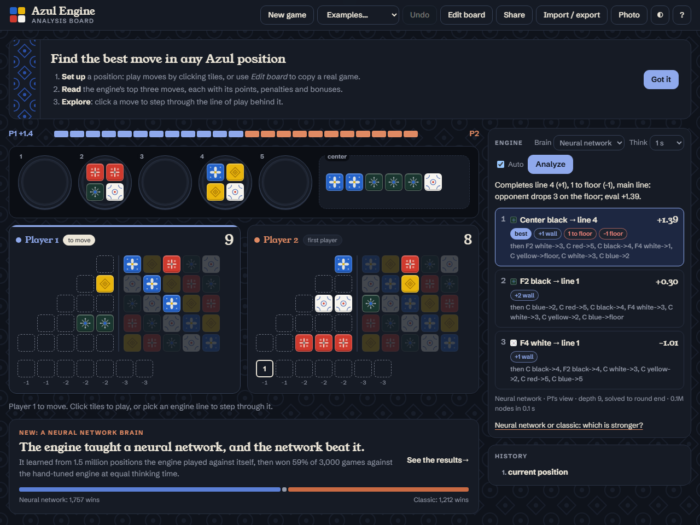

# Azul Engine

[](https://github.com/tusk80/azul-engine/actions/workflows/ci.yml)
[](https://github.com/tusk80/azul-engine/actions/workflows/site.yml)

**A game AI for 2-player Azul, and a neural network that learned to beat it.**

It started as a classic game engine: exact rules, alpha-beta search, and a
hand-written evaluation tuned by self-play. Then the engine generated 1.5 million
positions by playing itself, a small neural network learned from them, and in
3,000 games at equal thinking time **the network beat the hand-tuned evaluation
it learned from**. Then it played itself and got stronger again.

**[Try it in your browser](https://azul.yesil.cc)** · **[Neural vs classic: the benchmark](https://azul.yesil.cc/compare.html)** · [Dev log](https://azul.yesil.cc/blog.html) · [Technical write-up](docs/ML.md)

| Neural network vs hand-tuned evaluation | Result |
|---|---|
| Equal thinking time, 40 ms per move | **+174 ± 14 Elo** (73% of points, 3,000 games) |
| Self-play, against the first network it improved on | **+83 ± 13 Elo** (3,000 games) |
| Equal positions searched | **+141 ± 13 Elo** (3,000 games, 128 × 32 network) |



## Highlights

- **Machine learning:** supervised learning on 1.5M self-play positions, feature
  engineering that turned a tie into +141 Elo, a training target study, and a
  neural network trained from scratch in Go and benchmarked against PyTorch/CUDA.
- **Performance engineering:** an NNUE-style evaluator with an incremental,
  fixed-point first layer: 3.1× faster inference, worth +50 Elo with the same weights.
- **Algorithms:** alpha-beta (PVS) search with a transposition table, exact
  round solving, and SPSA parameter tuning.
- **Rigour:** every strength claim measured in thousands of paired games with
  confidence intervals; gradient checks, perft and brute-force tests.
- **Shipping:** one Go codebase as a CLI, an HTTP API and WebAssembly in the
  browser; CI, tagged releases and a static deploy to Cloudflare.

## What's inside

- **Rules engine.** Every Azul rule, a 110-byte copyable game state, incremental
  hashing, and a move generator checked by perft counts.
- **Search.** Negamax with principal-variation search, iterative deepening, a
  transposition table and move ordering. Later in a round it solves the rest of
  the round exactly. On several cores it runs Lazy SMP: helper threads share a
  lock-free table, each skipping depths on its own schedule (4 threads: +37 ± 12
  Elo at 40 ms per move, three times faster to depth 8).
- **Two evaluations, one search.**
  - *Classic*: fifteen hand-written terms, tuned by SPSA self-play.
  - *Neural*: a 170 → 64 → 16 → 1 network that predicts the final score margin.
- **Machine-learning pipeline.** Self-play data generation, training written
  from scratch in Go (no libraries) and again in PyTorch on a GPU as a benchmark,
  and match-based evaluation with confidence intervals.
- **Analysis board.** Set up or play any position, see the top three moves with a
  point breakdown, step through each line, choose the brain, share a link.
- **Runs anywhere.** One native binary (engine, HTTP API and web page), or
  compiled to WebAssembly and run entirely in the visitor's browser: the live
  site has no backend.
- **Browser overlay.** A userscript that shows the suggested move inside games
  on buddyboardgames.com.

## How the network was built

```
 self-play games ──► 1.5M positions ──► train (Go or PyTorch) ──► network JSON
  azul gendata        170 features        azul train / train.py        │
                      + 3 labels                                        ▼
                                          matches vs classic ◄── plugged into the search
                                          azul selfplay -a-net
```

1. **Data.** The engine plays 30,000 games against itself. Each position becomes
   170 integers seen from the side to move (walls, pattern lines, floors, scores,
   tiles on the table, and the board as it would look if the round were scored
   now), labelled with the search's value, the final margin and the result.
2. **Training.** A two-hidden-layer perceptron learns to predict the final
   margin, with a target mixing the search's value and the real outcome half and
   half. Adam, minibatches, a held-out validation set.
3. **Inference.** The network replaces the hand-written evaluation inside the same
   search. Like a chess NNUE, its first layer is kept between positions and only
   the inputs a move changed are applied, in exact integer arithmetic: three
   times faster than recomputing, worth about 50 Elo.
4. **Evaluation.** Matches with every deal played twice, seats swapped, at equal
   positions searched (what it knows) and at equal time (how it plays).

What made the difference, measured:

| Experiment | Elo vs classic |
|---|---|
| Raw board only, 128 × 32 | −7 ± 34 (a tie) |
| + the board as if scored now, 128 × 32 | **+141 ± 13** at equal positions |
| 128 × 32 at equal time, first version | +6 ± 24: knows more, too slow |
| 64 × 16 at equal time, first version | +64 ± 13 |
| 64 × 16 at equal time, 3× faster inference | +112 ± 13 |
| + one generation of self-play | +148 ± 14 |
| **+ a fine-tuned second self-play run** | **+174 ± 14**: the one that ships |
| Target: search value only / outcome only | −127 / −84 (raw board) |

Go and PyTorch, trained on the same data, reach the same validation error
(153.0 vs 153.2) and the same strength (+66 vs +64 in their first version), which also checks the
hand-written backpropagation. Details: [docs/ML.md](docs/ML.md).

## Quick start

Download the file for your system from the [latest release](https://github.com/tusk80/azul-engine/releases/latest)
and run it (on Windows, double-click it). It starts the engine and opens the
board at http://127.0.0.1:8765. Or build it (Go 1.26+):

```bash
go build -o azul ./cmd/azul
./azul
```

### Train your own network

```bash
./azul gendata -games 30000 -seed 1000000 -out ml/data.csv   # about 7 minutes on 24 cores
./azul train -data ml/data.csv -h1 64 -h2 16 -out net.json   # about 20 seconds
./azul selfplay -a-net net.json -b default -pairs 1500 -time 40ms
```

With PyTorch instead (uses a CUDA GPU if there is one):

```bash
python -m venv ml/.venv
ml/.venv/Scripts/pip install torch --index-url https://download.pytorch.org/whl/cu128
ml/.venv/Scripts/pip install numpy pandas
ml/.venv/Scripts/python ml/train.py --data ml/data.csv --h1 64 --h2 16 --out net.json
```

## The analysis board

- **Play** by clicking tiles, then a pattern line or the floor. *Score round* and
  *Deal next round* at the end of a round, or edit in the real deal.
- **Play vs engine**: take the side to move and the engine plays the other,
  scoring and dealing rounds as it goes.
- **Review game**: every move graded against the engine's choice (best, good,
  mistake, blunder) with each player's average points lost per move.
- **Engine**: the top three moves with their points, floor penalties and bonuses.
  **Brain** picks the neural network (default) or the classic evaluation.
- **Lines**: click a move to step through the line behind it with ◀ ▶.
- **Edit board** to copy a real game; **Photo** shows a picture of one beside the
  editor, and **Read with AI** fills the board in from it with your own Gemini or
  Anthropic key (kept in your browser).
- **Share** copies a link to the exact position; **Import / export** as JSON.

## Browser overlay (buddyboardgames.com)

1. Install [Tampermonkey](https://www.tampermonkey.net/), then open
   [azul-overlay.user.js](https://raw.githubusercontent.com/tusk80/azul-engine/main/userscript/azul-overlay.user.js)
   and press **Install**.
2. Optional: run the engine on your computer (`azul`, or double-click
   `azul.exe`). It is about three times faster. Without it the overlay loads
   the engine from azul.yesil.cc and runs it as WebAssembly in the tab.
3. In a 2-player game a panel shows the suggested move on your turn.
   **Alt+A** hides it, **Alt+S** opens the position on the board,
   **Alt+N** switches between the neural and classic brain, and **Alt+C**
   switches to casual play (best for your own board, no blocking the opponent).

Please use it for study, solo practice, or games where everyone knows about it.
Using an engine against people who don't know is cheating.

## Commands

| Command | What it does |
|---|---|
| `azul` | Run the engine and open the board. |
| `azul serve` | The same without opening a browser (`-public` adds limits for a public site). |
| `azul analyze state.json` | Search a position in the terminal. |
| `azul gendata` | Self-play positions as training data (CSV). |
| `azul train` | Train a network on that data. |
| `azul selfplay` | Engine-vs-engine match (`-a-net`, `-b-net` for networks). |
| `azul tune` | Tune the classic evaluation with SPSA. |
| `azul show`, `perft`, `random` | Print a board and its moves, count move sequences, play a random game. |

## HTTP API

| Endpoint | Body | Returns |
|---|---|---|
| `POST /bestmove` | `{"state": {...}, "timeMs": 1000, "multiPV": 3, "engine": "neural"}` | Best move with its effect, `eval` in points for the side to move, the line of play, alternatives and a one-line `reason`. `engine` is `classic` (default) or `neural`; `"style": "casual"` gives a relaxed move instead. |
| `POST /apply` | `{"state": {...}, "moves": ["F2 red->3", "score", "deal"]}` | Checks a position or plays a line, returning every position on the way. |
| `POST /new` | `{"seed": 0}` | A freshly dealt game. |

Errors are `{"error": "..."}` with status 400, 422 (no legal moves), 429 (rate
limit) or 503 (all engines busy). Positions look like
[testdata/midround.json](testdata/midround.json).

## Quality

- **Tests at every layer:** perft counts for move generation, the search checked
  against a plain alpha-beta reference and brute force (and mutation-tested), a
  numerical gradient check for the network's backpropagation, and API and HTTP
  tests. CI runs them on every push, plus the WebAssembly build.
- **No runtime dependencies:** the engine, server and network are standard-library
  Go. PyTorch is only for the benchmark.
- **Measured, not guessed:** every change to playing strength was adopted only
  after thousands of paired games. See [How the engine works](docs/HOW-IT-WORKS.md).

## Hosting

The `Site` workflow builds the static site (`hosting/build-site.sh`: the page
plus the engine as WebAssembly, about 3.8 MB) on every push and publishes it to
Cloudflare. `azul serve -public` runs it as a server instead, with a time cap per
search, an engine pool and per-visitor rate limits.

## Rules decisions

- Scores never go below 0.
- If nobody takes the first-player token, the same player starts the next round.
- The engine plays to win first, then to maximise the margin.

## Related work

- Mateusz Rzepecki, [*Implementing superhuman AI for Azul board game with a
  variation of NNUE*](https://jakubkowalski.tech/Supervising/Rzepecki2025ImplementingSuperhuman.pdf),
  master's thesis, University of Wrocław, 2025. The same recipe in C++:
  alpha-beta search with a small NNUE-style network, improved by a self-play
  training loop, and tested against people on Board Game Arena, where it reached
  first place. Differences here: the network learns the final margin and the
  search value instead of win/loss only, and the whole engine runs in the browser.
  Its biggest search gain, MTD(f) at the root, did not carry over here: +9 ± 12
  at 40 ms and +3 ± 12 at 200 ms per move over 3,000 games each, against this
  engine's principal variation search.

## Layout

```
cmd/azul/      CLI
cmd/wasm/      the engine for the browser
internal/
  game/        rules, move generation, scoring, hashing
  search/      alpha-beta search, transposition table
  eval/        the classic evaluation
  dataset/     features and self-play training data
  nn/          the network: inference, training, the shipped weights
  selfplay/    matches and SPSA tuning
  api/         requests and responses, shared by server and browser
  server/      HTTP API and the web pages (server/ui)
ml/            PyTorch trainer and the results page generator
blog/          dev log posts; python blog/build.py writes their pages
docs/          how the engine works, the ML write-up
hosting/       static site build and Cloudflare config
userscript/    the buddyboardgames.com overlay
weights/       classic evaluation weights
testdata/      example positions
```

Unofficial fan project. Azul is a trademark of its publishers; this project is
not affiliated with or endorsed by them.

## License

MIT. See [LICENSE](LICENSE).
